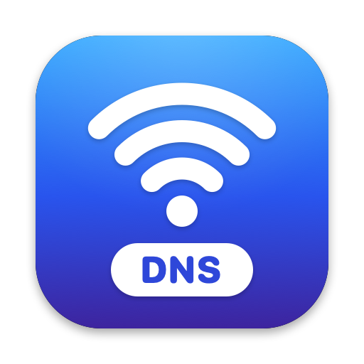
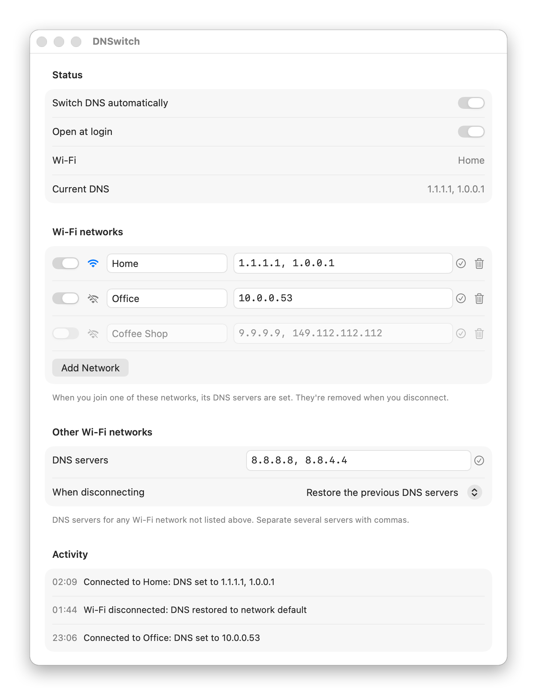

<p align="center">
  
</p>

<h1 align="center">DNSwitch</h1>

<p align="center">
  <b>Automatic DNS for every Wi-Fi network you join, on macOS.</b>
</p>

<p align="center">
  <a href="https://github.com/miladkhalafi/DNSwitch/releases/latest"></a>
  <a href="https://github.com/miladkhalafi/DNSwitch/actions/workflows/ci.yml"></a>
  
  <a href="LICENSE"></a>
</p>

<p align="center">
  <picture>
    <source media="(prefers-color-scheme: dark)" srcset="docs/settings-dark.png">
    
  </picture>
</p>

A macOS menu bar app that sets DNS servers when you join a Wi-Fi network and removes them when you disconnect.

- **Per network:** e.g. "Home" → `1.1.1.1, 1.0.0.1`, "Office" → `10.0.0.53`.
- **Other networks:** optional DNS servers for any Wi-Fi network you haven't listed.
- **On disconnect** (or when you quit DNSwitch or turn it off), it either restores the DNS servers you had before or clears them so the network's own DNS is used. You choose which.

DNSwitch uses macOS's own `networksetup` tool on the Wi-Fi service. It needs no system extension and no special permissions beyond Location access, which macOS requires before it reveals Wi-Fi network names.

Requires **macOS 14 Sonoma or newer** on Apple silicon or Intel.

## Install

```bash
curl -fsSL https://raw.githubusercontent.com/miladkhalafi/DNSwitch/main/install.sh | bash
```

The installer downloads the latest release, verifies its SHA-256 checksum, installs it to `/Applications` and launches it. Run the same command again to update.

<details>
<summary>Manual install, specific versions, uninstall</summary>

**Manual:** download `DNSwitch-x.y.z.zip` from [Releases](https://github.com/miladkhalafi/DNSwitch/releases/latest), unzip it and move `DNSwitch.app` to Applications. DNSwitch isn't notarized by Apple, so macOS blocks a copy downloaded in a browser the first time you open it. Open **System Settings → Privacy & Security** and click **Open Anyway**, or run:
```bash
xattr -dr com.apple.quarantine /Applications/DNSwitch.app
```

**Specific version:**
```bash
curl -fsSL https://raw.githubusercontent.com/miladkhalafi/DNSwitch/main/install.sh | bash -s -- --version v1.0.0
```

**Uninstall** (quits DNSwitch first, which puts your DNS back):
```bash
curl -fsSL https://raw.githubusercontent.com/miladkhalafi/DNSwitch/main/install.sh | bash -s -- --uninstall
```
</details>

## First run
1. Click the Wi-Fi icon in the menu bar and choose **Settings…**
2. Click **Allow…** to give Location access. Without it macOS hides Wi-Fi names, and only the "Other Wi-Fi networks" setting works.
3. Add networks (**Add "\<current network\>"** fills in the one you're on) and type their DNS servers, comma-separated.
4. Optional: turn on **Open at login**.

If macOS doesn't let DNSwitch change DNS directly, it asks for your admin password through the standard macOS prompt.

The menu bar icon is filled (●) while DNSwitch's DNS servers are active. **Activity** in Settings shows each change it made.

## Development

Requires Xcode 16+ and XcodeGen (`brew install xcodegen`). The Xcode project is generated from `project.yml` and isn't committed.

```bash
xcodegen generate && open DNSwitch.xcodeproj
```
Build and install your working copy to `/Applications`:
```bash
Scripts/dev-install.sh
```
Build the universal release zip into `dist/`:
```bash
Scripts/build-release.sh 1.2.3
```
Regenerate the app icon:
```bash
swift Scripts/make-icon.swift
```
Regenerate the README screenshots. This runs the app in demo mode with made-up networks, and nothing touches your DNS or settings:
```bash
Scripts/screenshots.sh
```

### Releasing
CI (`.github/workflows/ci.yml`) builds every push and pull request. To publish a release, push a version tag:
```bash
git tag v1.0.0 && git push origin v1.0.0
```
`.github/workflows/release.yml` then builds a universal (arm64 + x86_64) app with that version number and creates a GitHub Release. The release includes the zip and its `.sha256`, which is what `install.sh` downloads.

### Files
| File | What |
|---|---|
| `DNSwitch/WiFiMonitor.swift` | Detects connect/disconnect and the network name (CoreWLAN + NWPathMonitor) |
| `DNSwitch/DNSController.swift` | Reads/sets DNS via `networksetup` |
| `DNSwitch/AppState.swift` | Decides what DNS should be active; remembers and restores the previous DNS |
| `DNSwitch/Models.swift` | Rules, settings, address validation |
| `DNSwitch/DNSwitchApp.swift`, `SettingsView.swift` | Menu bar and settings window |
| `install.sh` | End-user installer (downloads a release) |
| `DNSwitch/Screenshots.swift` | Demo data and screenshot renderer for the README |
| `Scripts/` | Release build, dev install, icon and screenshot generators |

## License

[MIT](LICENSE) © 2026 Milad Khalafi
